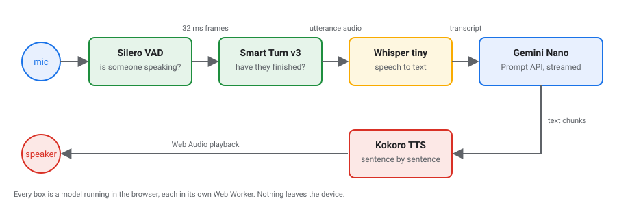

author: Kerry Ehikioya
summary: Build a real-time voice AI agent that runs entirely in the browser, one layer at a time: Gemini Nano, Kokoro, Whisper, streaming, voice activity detection and turn detection. No server, no API key.
id: browser-voice-agent
categories: web, ai, webgpu, chrome
environments: Web
status: Published
feedback link: https://github.com/kerry-okpere/browser-native-conversational-agents/issues
tags: devfest, webai, transformers.js, prompt-api

# Build a Real-Time Voice Agent in the Browser

## Overview
Duration: 0:03:00

In this codelab you build a voice agent that runs entirely inside Chrome. You talk, it listens, thinks and talks back, and nothing you say leaves your laptop.

You build it one layer at a time. Each layer is one idea, and each step turns it on by uncommenting a few lines in a single file.

| Step | Layer | What it adds | Model |
|---|---|---|---|
| 1 | Think | Type a question, get an answer | Gemini Nano, built into Chrome |
| 2 | Speak | The agent reads its answer out loud | Kokoro-82M |
| 3 | Listen | Hold a button, talk, and your words become the message | Whisper tiny |
| 4 | Real time | The agent starts talking before it has finished thinking | (no new model) |
| 5 | Hands-free | No button: the agent notices when you start and stop talking | Silero VAD |
| 6 | Turn detection | The agent tells a thinking pause apart from the end of a sentence | Smart Turn v3 |



### What you won't do

You won't write model-loading code, Web Workers, audio capture or UI. That is all done for you in `src/codelab/tools.ts` and `src/codelab/kit.ts`. You only work in **`src/codelab/agent.ts`**, and every line in it is about how the agent behaves.

<aside class="positive">
<strong>Lost at any point?</strong> <code>src/codelab/agent.done.ts</code> is the finished file with every step turned on. Copy it over yours and you are caught up: <code>cp src/codelab/agent.done.ts src/codelab/agent.ts</code>
</aside>

## Before you start: set up Chrome and Gemini Nano
Duration: 0:10:00

Do the three "Before you start" steps at home if you can. Gemini Nano is a large download, and venue Wi-Fi is shared by everyone in the room.

Gemini Nano is the language model built into Chrome. You don't download it from a website: Chrome downloads it for you, and every site shares the one copy.

### What you need

* **Desktop Chrome 148 or later** on Windows, macOS, Linux or a Chromebook Plus. The Prompt API is not on Android or iOS.
* **At least 22 GB of free disk space** on the drive that holds your Chrome profile. Chrome refuses to download the model with less.
* **A GPU with more than 4 GB of memory**, or **16 GB of RAM and 4 CPU cores**.
* **A microphone**.

You don't need to change any Chrome settings or flags. From Chrome 148 the Prompt API is on for every web page.

Copy the `chrome://` addresses below into the address bar yourself, because Chrome doesn't open them from links.

### 1. Update Chrome

Open `chrome://settings/help`. Chrome checks for updates; if it offers one, press **Relaunch**. The version number must be 148 or higher.

WebGPU, which lets the speech models use your GPU, is on by default in desktop Chrome. To check, open `chrome://gpu/` and look for **WebGPU: Hardware accelerated**. If it isn't, the codelab still works, just more slowly, because the models fall back to your CPU.

### 2. Check that Chrome can see Gemini Nano

Open any web page, open DevTools (**Cmd+Option+J** on Mac, **Ctrl+Shift+J** on Windows and Linux) and paste this into the Console:

```js
await LanguageModel.availability()
```

What the answer means:

| Answer | What to do |
|---|---|
| `"available"` | The model is on your laptop. Go to the next page. |
| `"downloadable"` or `"downloading"` | It's turned on but not fully downloaded yet. The **Download models** button on the next page downloads it. |
| `"unavailable"` | Your device doesn't meet the requirements above. Check disk space first. |
| `ReferenceError: LanguageModel is not defined` | Your Chrome is older than 148, or isn't desktop Chrome. Update it (step 1) and relaunch. |

### 3. See the model's status

`chrome://on-device-internals/` shows whether the model is downloaded and ready. You'll come back here while it downloads.

## Before you start: get the code and download the models
Duration: 0:10:00

### Get the code

You need **Node.js 20 or later**.

```console
git clone https://github.com/kerry-okpere/browser-native-conversational-agents.git
cd browser-native-conversational-agents
git checkout feat/voice-agent-call
npm install
npm run dev
```

`npm install` brings in the libraries the models run on: **Transformers.js** (Whisper, Silero VAD and Smart Turn) and **kokoro-js** (Kokoro). You won't import either one yourself.

Open **http://localhost:2006/codelab.html**. Keep this tab open for the whole codelab.

### Download every model with one click

Press **Download models**. The page fetches all five models at once and shows progress for each:

| Model | Size | Comes from |
|---|---|---|
| Gemini Nano | a few GB, once per computer | Chrome |
| Whisper tiny | ~74 MB | Hugging Face |
| Kokoro-82M | ~92 MB | Hugging Face |
| Silero VAD | ~2 MB | Hugging Face |
| Smart Turn v3 | ~8 MB | Hugging Face |

The models are saved in the browser, so this only happens once. After a reload the page loads them from disk without a click.

<aside class="negative">
Chrome only starts the Gemini Nano download after a click. That is why it's a button and not automatic.
</aside>

### Check

All five rows read **Ready**. Then open `src/codelab/agent.ts` in your editor. The page reloads by itself every time you save it.

## Step 1: Ask Gemini Nano a question
Duration: 0:05:00

**Layer:** Think. Type a question, get an answer.

At the top of `agent.ts` is the system prompt and the code that opens a session on Gemini Nano. Read it, there's nothing to change:

```ts
const SYSTEM_PROMPT = `You are a friendly voice assistant.
Reply the way a person talks: one or two short sentences.
Never use lists, markdown or emojis, because your reply is read aloud.`;

async function getSession() {
  if (!session) {
    session = await LanguageModel.create({
      initialPrompts: [{ role: "system", content: SYSTEM_PROMPT }],
      expectedOutputs: [{ type: "text", languages: ["en"] }],
    });
  }
  return session;
}
```

`LanguageModel` is a global in Chrome, so there's no import, API key or server. The system prompt asks for speech-shaped answers because in the next step they are read aloud.

### Turn it on

In `onText()`, uncomment these two lines:

```ts
const answer = await (await getSession()).prompt(text);
chat.agent(answer);
```

`prompt()` sends your message and waits for the whole answer. The session remembers earlier messages, so you can ask follow-up questions.

### Check

Type "What can you help me with?" and press **Send**. A one- or two-sentence answer appears. Ask a follow-up such as "Tell me more about the first one" to see that it remembers.

## Step 2: Give the agent a voice with Kokoro
Duration: 0:05:00

**Layer:** Speak. The answer is read out loud.

Kokoro-82M is a small text-to-speech model. It runs in a Web Worker so the page doesn't freeze while it generates audio, on your GPU through WebGPU when there is one.

### Turn it on

In `onText()`, uncomment:

```ts
await tts.speak(answer);
```

Text goes in, and you hear the audio.

### Check

Send "Tell me a fun fact about Abuja." You should hear the answer.

Notice the wait: nothing plays until Gemini Nano has written the **whole** answer and Kokoro has turned **all** of it into audio. Step 4 fixes that.

## Step 3: Talk instead of typing with Whisper
Duration: 0:05:00

**Layer:** Listen. Hold a button, talk, and your words become the message.

The page records your microphone while you hold **Hold to talk** and passes the audio to `onVoice()`. Whisper turns it into text.

### Turn it on

In `onVoice()`, uncomment:

```ts
const text = await transcribe(audio);
if (text) await onText(text);
```

The transcript goes into `onText()`, the same function the Send button uses. Speech is just another way to type, so everything after this point works for both.

`transcribe()` returns an empty string when Whisper heard no words. Whisper writes things like `[BLANK_AUDIO]` for silence, and those are dropped.

### Check

Hold **Hold to talk**, say "What's the capital of Nigeria?", and let go. Chrome asks for the microphone the first time; allow it. Your words appear as a message, and the agent answers out loud.

## Step 4: Real time, speak while it is still thinking
Duration: 0:08:00

**Layer:** Real time. The agent starts talking before it has finished thinking.

In step 2 the agent stayed quiet until the whole answer was written and turned into audio. A person starts talking as soon as they have their first sentence. This step does the same with two changes:

1. **Stream the reply.** `promptStreaming()` hands over the answer a few words at a time instead of all at the end.
2. **Speak each sentence as soon as it is complete.** The first sentence plays while Gemini Nano is still writing the second.

Read `replyInRealTime()` in `agent.ts`. This is the part that matters:

```ts
const stream = (await getSession()).promptStreaming(text);
for await (const chunk of stream) {
  bubble.append(chunk);       // show the words as they arrive
  unspoken += chunk;

  let sentence;
  while ((sentence = unspoken.match(SENTENCE))) {
    spoken.push(tts.speak(sentence[0]));   // speak each finished sentence now
    unspoken = unspoken.slice(sentence[0].length);
  }
}
spoken.push(tts.speak(unspoken));   // whatever is left at the end
```

`SENTENCE` matches text up to a `.`, `!` or `?` that has a space after it, so "3.5" isn't cut in half. `tts.speak()` queues, so sentences play in order while the next one is already being generated.

### Turn it on

In `onText()`, comment out the three lines from steps 1 and 2 and uncomment:

```ts
await replyInRealTime(text);
```

### Check

Ask "Tell me a short story about a lighthouse." The words appear as they're written, and you hear the first sentence before the bubble is finished. Compare it with step 2 and you'll notice the wait is shorter.

## Step 5: Hands-free with voice activity detection
Duration: 0:08:00

**Layer:** Hands-free. No button. The agent notices when you start and stop talking.

Voice activity detection (VAD) listens to the microphone. Silero VAD scores every 32 ms of audio from 0 to 1 for how likely it is to be speech, and calls you back when you start talking and when you stop.

### Turn it on

In `startCall()`, uncomment everything inside the function. Leave the lines marked STEP 6 commented for now. Here's what you get:

```ts
await vad.listen({
  onSpeechStart: () => {
    chat.status("Hearing you…");
  },
  onSpeechEnd: (audio) => {
    chat.status("Thinking…");
    onVoice(audio).finally(() => chat.status("Listening"));
  },
  onSpeechCancel: () => chat.status("Listening"), // a cough or a click, not speech
});
```

`onSpeechEnd` hands the audio to `onVoice()`, the same function Hold to talk uses. VAD does the job your finger did on the button in step 3.

<aside class="positive">
Select the whole commented block and press <strong>Cmd+/</strong> (Mac) or <strong>Ctrl+/</strong> (Windows, Linux). The STEP 6 lines stay commented, because they have a second <code>//</code>.
</aside>

Look at `replyInRealTime()` again. It already has two lines from this step:

```ts
vad.pause();    // before the reply: don't listen while the agent talks
...
vad.resume();   // after the reply has been spoken
```

Without them, the agent would hear its own voice through your speakers and answer itself.

### Check

Press **Start call** and say "Hello, can you hear me?" The status reads **Hearing you…** while you talk, and the agent answers about half a second after you stop. Clap once: the status flickers and goes back to **Listening** with no message.

Now say "I was thinking about…", pause for one second, and finish the sentence. The agent probably cuts in during the pause. Step 6 fixes that.

## Step 6: Turn detection, know when the user has finished
Duration: 0:06:00

**Layer:** Turn detection. The agent tells a thinking pause apart from the end of a sentence.

In step 5 the turn ends after half a second of silence. That's a guess. Make it shorter and the agent interrupts you while you think; make it longer and every answer feels slow.

Smart Turn v3 replaces the guess with a judgement. At each short pause it listens to **how** you said the last few seconds, your intonation and rhythm, and returns how sure it is that you've finished.

### Turn it on

In `startCall()`, uncomment `isTurnComplete`:

```ts
isTurnComplete: async (audio) => {
  const { complete, probability } = await turn.check(audio);
  chat.note(`Turn detection: ${Math.round(probability * 100)}% sure you've finished`);
  return complete;
},
```

The VAD asks this after 200 ms of silence. If the answer is "finished", the turn ends right away. If not, it keeps listening. After 2.5 s of silence the turn ends whatever the model says.

### Check

Press **Start call** again, because the page reloaded when you saved. Say "I was thinking about…" and pause. A note shows a low percentage, and the agent waits. Finish with "…what to have for lunch." The percentage is high and the agent answers.

## Wrap-up
Duration: 0:02:00

You built a real-time voice agent where every model runs on your laptop:

* **Gemini Nano** thinks.
* **Kokoro** speaks.
* **Whisper** listens.
* **Streaming** lets it talk while it thinks.
* **Silero VAD** knows when you're talking.
* **Smart Turn** knows when you've finished.

No audio or text leaves the browser, it works offline once the models are saved, and there is no bill per request.

### Go further

* **Read the full app.** `npm run dev` and open http://localhost:2006 for the version in the talk, with the animated orb and latency timings under every message. Its loop is in `src/pipeline/call.ts`.
* **Tool calling.** The Prompt API has no tool calling built in. Ask for structured output with `responseConstraint` (a JSON schema) and act on the answer. The full app uses this to let the agent hang up when you say goodbye.
* **Images.** Gemini Nano can look at images too: pass `{ type: "image" }` in `expectedInputs` and send a picture with your message.

### Resources

* Source: [browser-native-conversational-agents](https://github.com/kerry-okpere/browser-native-conversational-agents/tree/feat/voice-agent-call)
* Chrome built-in AI and the Prompt API: [developer.chrome.com/docs/ai/built-in](https://developer.chrome.com/docs/ai/built-in)
* Transformers.js: [huggingface.co/docs/transformers.js](https://huggingface.co/docs/transformers.js)
* Models: [Kokoro-82M](https://huggingface.co/onnx-community/Kokoro-82M-v1.0-ONNX), [whisper-tiny](https://huggingface.co/Xenova/whisper-tiny), [silero-vad](https://huggingface.co/onnx-community/silero-vad), [smart-turn-v3](https://huggingface.co/pipecat-ai/smart-turn-v3)
