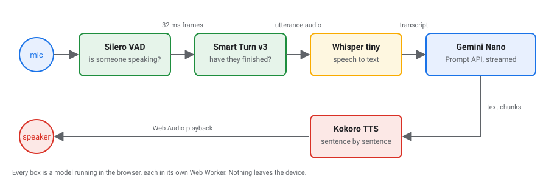

author: Kerry Ehikioya
summary: Build a hands-free voice AI agent that runs entirely in the browser with Gemini Nano, Whisper, Kokoro, Silero VAD and Smart Turn. No server, no API key, nothing leaves the device.
id: browser-voice-agent
categories: web, ai, webgpu, chrome
environments: Web
status: Published
feedback link: https://github.com/kerry-okpere/browser-native-conversational-agents/issues
tags: devfest, webai, transformers.js, prompt-api

# Build a Voice AI Agent in the Browser

## Overview
Duration: 0:05:00

In this codelab you build a voice agent that runs entirely in the browser. You speak, it listens, thinks and talks back, and no audio or text ever leaves your device.

Every stage is a model running in Chrome:

| Stage | Model | Runs through | Size |
|---|---|---|---|
| Thinking | Gemini Nano | Chrome Prompt API | managed by Chrome |
| Speech to text | Whisper tiny | Transformers.js | ~74 MB |
| Text to speech | Kokoro-82M | kokoro-js (Transformers.js) | ~92 MB |
| Voice activity | Silero VAD | Transformers.js / ONNX | ~2 MB |
| Turn detection | Smart Turn v3 | Transformers.js / ONNX | ~8 MB |



Audio flows left to right across the top and the reply comes back along the bottom.

### What you will build

1. Download Gemini Nano and give it a system prompt.
2. Chat with it from an input box, with streamed replies.
3. Give it a voice with Kokoro TTS, spoken sentence by sentence.
4. Add speech input with Whisper through Transformers.js.
5. Wire the stages into a real-time call loop.
6. Add voice activity detection so the microphone stays open hands-free.
7. Add turn detection so the agent knows a pause from the end of a sentence.

### What you need

* **Desktop Chrome 138 or later.** The Prompt API that exposes Gemini Nano is desktop only.
* **WebGPU on.** Open `chrome://gpu/` and look for "WebGPU: Hardware accelerated". Without it the models fall back to Wasm on the CPU: it works, just slower.
* **Disk space.** About 22 GB free for Chrome to download Gemini Nano, plus roughly 400 MB for the other models. Check model status at `chrome://on-device-internals/`.
* **Node.js 20 or later**, and a microphone.

<aside class="negative">
Start the Gemini Nano download before the session if you can: press Start in the app once and leave it. It is the biggest download by far and depends on your connection.
</aside>

### Get the code

```console
git clone https://github.com/kerry-okpere/browser-native-conversational-agents.git
cd browser-native-conversational-agents
git checkout feat/voice-agent-call
npm install
npm run dev
```

The dev server opens on port `2006`.

### How the project is laid out

Plain TypeScript and Web Components on Vite, no framework. Each model runs in its own Web Worker so inference never blocks the UI, and a small `pipeline/` module on the main thread talks to each worker over `postMessage`.

```
src/
  pipeline/      one file per stage: llm.ts, stt.ts, vad.ts, turn.ts, tts/, and call.ts for the loop
  workers/       the model code that runs off the main thread
  components/    start-button, chat-box, voice-orb, call-controls
  init.ts        builds the stages and the call
  main.ts        entry point
```

Every stage implements the same `Stage` contract from `src/pipeline/index.type.ts`: `isDownloaded()`, `load(onProgress)`, `warmUp()`, `destroy()`. That shared shape is what lets the start screen download, load and warm up all five models in parallel with one loop.

<aside class="positive">
<strong>Following along live?</strong> Each step names the files it touches and ends with a <strong>Check</strong> you can run in the browser. If you fall behind, jump to that step's checkpoint with <code>git checkout codelab/step-N</code> and carry on from there.
</aside>

## Step 1: Download Gemini Nano and set a system prompt
Duration: 0:10:00

Gemini Nano is Chrome's built-in model. You never download weights yourself: Chrome owns the model, every site shares the one copy, and you reach it through the `LanguageModel` global of the Prompt API.

**File:** `src/pipeline/llm.ts`

### Check availability first

`LanguageModel.availability()` answers `available`, `downloadable`, `downloading` or `unavailable`. Pass the same options you will create the session with, so Chrome checks the right configuration.

```ts
const OPTIONS: CreateOptions = {
  expectedInputs: [{ type: "text", languages: ["en"] }],
  expectedOutputs: [{ type: "text", languages: ["en"] }],
};

const supported = () => "LanguageModel" in self;
const availability = async () =>
  supported() ? LanguageModel.availability(OPTIONS) : "unavailable";
```

### Write the system prompt for speech, not text

The reply will be read aloud, so the prompt bans lists, markdown and emoji and asks for one or two short sentences. This single change is most of what makes the agent sound like a person rather than a chatbot.

```ts
const SYSTEM_PROMPT = `You are a friendly voice assistant having a spoken conversation.
Reply the way a person talks: one or two short, natural sentences.
Never use lists, markdown, emojis, or headings, because your reply is read aloud.
If you need more detail to help, ask one short question.`;
```

### Create the session and watch the download

`LanguageModel.create()` takes the system prompt as the first of its `initialPrompts`. If the model is not on the device yet, Chrome downloads it during this call and the `monitor` callback reports progress. The session is cached in a promise so every caller shares one model, and cleared on failure so a retry can work.

```ts
let session: Promise<Session> | null = null;

function getSession() {
  session ??= (async () => {
    if (!supported()) {
      throw new Error("This browser does not have the built-in Prompt API (needs desktop Chrome 138+).");
    }
    const created = await LanguageModel.create({
      ...OPTIONS,
      initialPrompts: [{ role: "system", content: SYSTEM_PROMPT }],
      monitor(monitor) {
        monitor.addEventListener("downloadprogress", (event) => {
          onDownloadProgress?.((event as ProgressEvent).loaded);
        });
      },
    });
    loaded = true;
    return created;
  })();
  session.catch(() => { session = null; });
  return session;
}
```

### Warm up on a throwaway clone

The first prompt to a fresh session is slow, so `warmUp()` sends "Hi" once, to a `clone()` of the session that is destroyed afterwards. The warm-up never becomes part of the real conversation.

```ts
warmUp() {
  warmingUp ??= (async () => {
    const base = await getSession();
    const copy = await base.clone();
    try { await copy.prompt("Hi"); } finally { copy.destroy(); }
  })();
  return warmingUp;
}
```

<aside class="negative">
<strong>Two rules Chrome enforces.</strong> The download only starts in response to a user gesture, so <code>load()</code> must be called from a click handler. That is why the app has a Start button instead of loading on page load. And a page can unload the model with <code>session.destroy()</code> but cannot delete it, because Chrome owns the files.
</aside>

### Check

Open `chrome://on-device-internals/`, then press **Start** in the app. The LLM row on the start screen should move from "Downloading…" to "Ready in Ns", and the internals page should show the model as ready.

## Step 2: Chat with Gemini Nano through an input box
Duration: 0:08:00

Before any audio, prove the model works with text. The `<chat-box>` component is a form with one input; submitting it calls `call.send(text)` and the reply streams into a bubble as it is generated.

**Files:** `src/components/chat-box/chat-box.ts`, `src/pipeline/llm.ts`, `src/pipeline/call.ts`

### Stream the reply

`promptStreaming()` returns a `ReadableStream` of text chunks. `reply()` reads it chunk by chunk, hands each piece to `onChunk` and returns the full text at the end. Streaming is what later lets the agent start talking before it has finished thinking.

```ts
async reply(text, onChunk) {
  const reader = (await getSession()).promptStreaming(text).getReader();
  let full = "";
  while (true) {
    const { done, value } = await reader.read();
    if (done) break;
    full += value;
    onChunk(value);
  }
  return full;
}
```

### Handle the submit

The chat box keeps a `call` reference and forwards typed text to it. It never talks to the model directly, so the same component keeps working once speech is added.

```ts
form.addEventListener("submit", (event) => {
  event.preventDefault();
  const text = input.value;
  input.value = "";
  this.source?.send(text);
});
```

### Update the bubble in place

A reply arrives many times with the same `id` as it grows. A `Map` from reply id to bubble means each chunk replaces the bubble text instead of adding a new one. The small line under each bubble shows timings you will care about later: Time to First Text and Time to Last Text.

```ts
const replies = new Map<number, ReturnType<typeof addMessage>>();

call.on("reply", (reply) => {
  const bubble = replies.get(reply.id) ?? addMessage("assistant");
  replies.set(reply.id, bubble);
  bubble.message.textContent = reply.error ? `Something went wrong: ${reply.error}` : reply.text;
  bubble.meta.textContent = describeReply(reply);
});
```

On the call side, `send()` in `call.ts` stamps a turn number, emits a `user` event for the chat box, then calls `respond()`, which runs `llm.reply()` and emits `reply` events as chunks arrive. The turn number is how work for an older message is ignored once a newer one arrives.

### Check

Type "What can you help me with?" and send it. The reply should appear word by word, stay to one or two sentences, and carry no markdown. If it comes back as a bulleted list, your system prompt is not reaching the session.

## Step 3: Give the agent a voice with Kokoro TTS
Duration: 0:12:00

Kokoro-82M is a small, good-sounding text-to-speech model that ships as ONNX. The `kokoro-js` package loads it with Transformers.js, so it runs on WebGPU when there is one and Wasm when there is not. About 92 MB, downloaded once and kept in Cache Storage.

**Files:** `src/workers/tts-kokoro.ts`, `src/pipeline/tts/index.tts.ts`, `src/pipeline/tts/kokoro.tts.ts`, `src/pipeline/call.ts`

### Run the model in a worker

Generating speech takes hundreds of milliseconds, so it happens in a Web Worker. The worker speaks a tiny protocol: it receives `tts:load` and `tts:generate`, and sends back `tts:loading`, `tts:ready`, `tts:complete` or `tts:error`.

```ts
import { KokoroTTS } from "kokoro-js";

const MODEL_ID = "onnx-community/Kokoro-82M-v1.0-ONNX";
const VOICE = "af_bella";
let model: Promise<KokoroTTS> | null = null;

function load() {
  model ??= (async () => {
    const gpu = await (navigator as any).gpu?.requestAdapter().catch(() => null);
    return KokoroTTS.from_pretrained(MODEL_ID, {
      device: gpu ? "webgpu" : "wasm",
      dtype: gpu ? "fp32" : "q8",
      progress_callback: (info) => {
        if (info.status === "progress" && info.file.endsWith(".onnx")) {
          self.postMessage({ status: "tts:loading", fraction: info.total ? info.loaded / info.total : 0 });
        }
      },
    });
  })();
  model.catch(() => { model = null; });
  return model;
}

async function generate(id: number, text: string) {
  const audio = await (await load()).generate(text, { voice: VOICE });
  self.postMessage({ status: "tts:complete", id, audio: audio.toBlob() });
}
```

Full precision on the GPU and the quantized `q8` build on the CPU: every model in this project makes the same trade-off.

### Put the engine behind a base class

`TtsEngine` owns the worker, the load promise and playback. A concrete engine only says which worker to create and how to find its files in the cache. That is why `KokoroTts` is 25 lines and a Piper engine sits next to it as a drop-in alternative.

```ts
export class KokoroTts extends TtsEngine {
  private static MODEL = "Kokoro-82M";
  protected createWorker() {
    return new Worker(new URL("../../workers/tts-kokoro.ts", import.meta.url), { type: "module" });
  }
  isDownloaded() {
    return hasCached(TRANSFORMERS_CACHE, KokoroTts.MODEL);
  }
  protected async deleteFiles() {
    await deleteCached(TRANSFORMERS_CACHE, KokoroTts.MODEL);
    await caches.delete("kokoro-voices");
  }
}
```

### Queue sentences, generate ahead, play in order

`speak(text)` keeps two promise chains. `generating` makes sure one piece of audio is synthesised at a time; `playback` makes sure pieces play in the order they were asked for. Because the chains are separate, the next sentence is already being generated while the current one plays. A `queue` counter lets `stop()` drop everything that has not played yet.

```ts
speak(text: string, onStart?: () => void) {
  const speakable = cleanForSpeech(text);
  if (!speakable) return Promise.resolve();

  const queue = this.queue;
  const cancelled = () => queue !== this.queue;

  const audio = this.generating
    .then(() => this.load())
    .then(() => (cancelled() ? null : this.generate(speakable)));
  this.generating = audio.catch(() => {});

  const spoken = this.playback.then(async () => {
    const blob = await audio;
    if (blob && !cancelled()) await this.play(blob, cancelled, onStart);
  });
  this.playback = spoken.catch(() => {});
  return spoken;
}
```

`cleanForSpeech` strips emoji, otherwise the model reads "grinning face" out loud. Playback goes through Web Audio rather than an `<audio>` element so an `AnalyserNode` can read the spectrum for the orb animation.

### Speak each sentence as it lands

In `respond()`, every streamed chunk is appended to an `unspoken` buffer. A regex pulls out complete sentences and sends each to `tts.speak()` straight away, so the first sentence is playing while the model is still writing the second. The `(?=\s)` lookahead waits for a space after the punctuation so "3.5" is not cut in half.

```ts
const SENTENCE = /^[\s\S]*?[.!?]+(?=\s)/;

unspoken += chunk;
let sentence: RegExpMatchArray | null;
while ((sentence = unspoken.match(SENTENCE))) {
  speak(sentence[0]);
  unspoken = unspoken.slice(sentence[0].length);
}
```

### Check

Send a message from the chat box. You should hear the first sentence before the full reply has finished appearing, and the meta line should now show Time to First Audio. Send a second message while it is talking: `send()` calls `tts.stop()` first, so the old reply cuts off.

## Step 4: Add speech input with Whisper via Transformers.js
Duration: 0:10:00

Whisper tiny turns 16 kHz mono audio into text. Transformers.js gives you an `automatic-speech-recognition` pipeline that downloads the ONNX files from Hugging Face, caches them and runs them in the browser. About 74 MB.

**Files:** `src/workers/stt.ts`, `src/pipeline/stt.ts`, `src/constants.ts`

### Split the model across backends

Whisper has an encoder, which is heavy and runs once per utterance, and a decoder, which is light and runs once per token. The encoder goes on WebGPU at full precision; the decoder stays on Wasm in `q8`, because a token-at-a-time loop gains little from the GPU and pays a round trip each step.

```ts
import { pipeline, type AutomaticSpeechRecognitionPipeline } from "@huggingface/transformers";
import { SAMPLE_RATE } from "../constants";

const MODEL_ID = "Xenova/whisper-tiny";
let transcriber: Promise<AutomaticSpeechRecognitionPipeline> | null = null;

function load() {
  transcriber ??= (async () => {
    const gpu = await (navigator as any).gpu?.requestAdapter().catch(() => null);
    const asr = await pipeline("automatic-speech-recognition", MODEL_ID, {
      device: { encoder_model: gpu ? "webgpu" : "wasm", decoder_model_merged: "wasm" },
      dtype: { encoder_model: gpu ? "fp32" : "q8", decoder_model_merged: "q8" },
      progress_callback: handleProgress,
    });
    await asr(new Float32Array(SAMPLE_RATE)); // warm up on one second of silence
    return asr;
  })();
  return transcriber;
}

async function generate(id: number, audio: Float32Array) {
  const result = await (await load())(audio);
  const text = Array.isArray(result) ? result[0].text : result.text;
  self.postMessage({ status: "stt:complete", id, text: text.trim() });
}
```

### Wrap the worker on the main thread

`createStt()` follows the same shape as the TTS engine: a lazily created worker, a `load` promise that resolves on `stt:ready`, and a `Map` of pending transcriptions keyed by request id.

```ts
transcribe: (audio) =>
  new Promise((resolve, reject) => {
    const id = nextId++;
    transcriptions.set(id, { resolve, reject });
    getWorker().postMessage({ type: "stt:generate", id, data: audio });
  }),
```

<aside class="negative">
The worker <code>error</code> listener matters more than it looks. A worker that crashes while loading sends no message at all, so without it <code>load()</code> waits forever and the start screen hangs.
</aside>

### Get audio at the right rate

Whisper wants 16 kHz mono `Float32Array` samples. You do not resample by hand: an `AudioContext` created with `{ sampleRate: 16000 }` resamples the microphone for you. `SAMPLE_RATE` in `src/constants.ts` is the one place that number lives.

### Check

Nothing is wired to the microphone yet, so test the worker alone from the console: record a few seconds with `MediaRecorder`, decode with `toSamples()` from `src/helpers.ts`, pass the samples to `stt.transcribe()` and log the text. Whisper marks silence with tags like `[BLANK_AUDIO]`; the call loop filters those out in the next step.

## Step 5: Wire up the real-time call flow
Duration: 0:12:00

`VoiceCall` in `src/pipeline/call.ts` is the only place the stages meet. It is a small state machine with six states (`idle`, `starting`, `listening`, `hearing`, `thinking`, `speaking`) and it emits events the UI subscribes to: `state`, `user`, `reply` and `closed`. Nothing in the components knows which model is behind a stage.

**Files:** `src/init.ts`, `src/pipeline/call.ts`, `src/main.ts`

### Build the stages once

`init()` creates the five stages, hands them to `VoiceCall`, and exposes `start` for the start screen. Because every stage shares the `Stage` contract, one loop downloads, loads and warms them all up in parallel.

```ts
const vad = createVad();
const turn = createTurn();
const stt = createStt();
const llm = createLlm();
const tts: Tts = new KokoroTts();

const stages: Record<StageName, Stage> = { vad, turn, stt, llm, tts };

const start: Start = async (onUpdate) => {
  const startStage = async (name: StageName, stage: Stage) => {
    const downloaded = await stage.isDownloaded();
    onUpdate(name, downloaded ? { state: "loading" } : { state: "downloading", fraction: 0 });
    await stage.load((fraction) => {
      if (!downloaded && fraction < 1) onUpdate(name, { state: "downloading", fraction });
    });
    await stage.warmUp();
    onUpdate(name, { state: "ready", ms: performance.now() - started, saved: await stage.isDownloaded() });
  };
  await Promise.all(names.map((name) => startStage(name, stages[name])));
};

const call = new VoiceCall({ vad, turn, stt, llm, tts });
```

### Open the microphone and hand it to VAD

`start()` calls `vad.listen()` with handlers for the three things the loop cares about: speech started, speech ended with the audio, and a sound too short to count. You add the VAD itself in the next step; here it is the contract that matters.

```ts
async start() {
  this.setState("starting");
  await vad.listen({
    onSpeechStart: () => { if (this.current === "listening") this.setState("hearing"); },
    onSpeechCancel: () => { if (this.current === "hearing") this.setState("listening"); },
    onSpeechEnd: (audio, silence) => this.onSpeech(audio, silence),
  });
  llm.warmUp().catch(() => {});
  this.setState("listening");
}
```

### Turn speech into a reply

`onSpeech()` transcribes the audio, drops anything Whisper tagged as non-speech, emits the `user` message and calls `respond()`. The `turn` counter is bumped at the start; any step that finds `turn !== this.turn` afterwards knows a newer turn has overtaken it and returns quietly.

```ts
const NOT_SPEECH = /^[[(].*[\])]$/; // "[BLANK_AUDIO]", "(wind blowing)"

private async onSpeech(audio: Float32Array, silence: number) {
  if (this.current !== "hearing") return;
  const turn = ++this.turn;
  const origin = performance.now() - silence;
  this.setState("thinking");

  const text = (await this.stages.stt.transcribe(audio)).trim();
  if (turn !== this.turn) return;
  if (!text || NOT_SPEECH.test(text)) { this.setState("listening"); return; }

  this.emit("user", { id: this.nextId++, text, at: timestamp(), from: "speech", finalSegment: performance.now() - origin, vadWait: silence });
  await this.respond(text, origin, "speech", turn);
}
```

`origin` is the moment the user actually stopped talking, not the moment detection confirmed it. Every latency on the meta line is measured from there, because that is the number the user feels.

### Mute the mic while the agent talks

`respond()` pauses VAD before streaming the reply and resumes it 250 ms after the last sentence finishes, so the tail of the agent's own voice is not heard as the user.

```ts
vad.pause();
this.setState("thinking");
// ... stream the reply, speak each sentence ...
await Promise.all(spoken);
this.setState("listening");
setTimeout(() => { if (isCurrent()) vad.resume(); }, RESUME_DELAY);
```

`main.ts` mirrors the state onto `<body data-call="...">`, which is all the CSS needs to swap between the start screen and the call view. The orb reads `call.bands()`: the microphone spectrum while listening, the TTS spectrum while speaking.

### Check

Press **Start**, wait for all five rows to read Ready, and say "Hello, can you hear me?". The orb should move while you speak, the state label should go Hearing you, Thinking, Speaking, and the transcript and reply should both land in the chat box with their timings.

## Step 6: Add voice activity detection (VAD)
Duration: 0:12:00

VAD is what makes the call hands-free. Instead of a push-to-talk button, Silero VAD listens to the microphone 32 ms at a time and says how likely each frame is to contain speech. The pipeline turns those probabilities into "speech started", "speech ended, here is the audio" and "that was just noise". About 2 MB.

**Files:** `src/workers/mic-processor.ts`, `src/workers/vad.ts`, `src/pipeline/vad.ts`, `src/constants.ts`

### Cut the microphone into frames on the audio thread

An `AudioWorkletProcessor` runs on the browser's real-time audio thread. `MicProcessor` collects samples into 512-sample frames (32 ms at 16 kHz) and posts each one out. It does no detection itself; the audio thread must never block.

```ts
class MicProcessor extends AudioWorkletProcessor {
  private frame = new Float32Array(VAD.frame);
  private filled = 0;

  process(inputs: Float32Array[][]) {
    const samples = inputs[0]?.[0];
    if (samples) {
      for (const sample of samples) {
        this.frame[this.filled++] = sample;
        if (this.filled === VAD.frame) {
          this.port.postMessage(this.frame.slice());
          this.filled = 0;
        }
      }
    }
    return true;
  }
}
registerProcessor("mic-processor", MicProcessor);
```

### Open the mic with echo cancellation on

Echo cancellation is the browser removing the agent's own voice from the microphone signal; without it the agent would hear itself. The `AudioContext` is created at 16 kHz so the browser resamples for you, and frames go straight from the worklet to the VAD worker as transferable buffers.

```ts
stream = await navigator.mediaDevices.getUserMedia({
  audio: { echoCancellation: true, noiseSuppression: true, autoGainControl: true, channelCount: 1 },
});
context = new AudioContext({ sampleRate: SAMPLE_RATE });
await context.audioWorklet.addModule(micProcessorUrl);

const source = context.createMediaStreamSource(stream);
const frames = new AudioWorkletNode(context, "mic-processor", { numberOfOutputs: 0 });
source.connect(frames);
frames.port.onmessage = (event: MessageEvent<Float32Array>) => {
  if (paused) return;
  getWorker().postMessage({ type: "vad:frame", data: event.data }, [event.data.buffer]);
};
```

### Run Silero one frame at a time

The model is stateful: it returns a new `stateN` tensor with each frame, which you feed back on the next call, so it remembers what it just heard.

```ts
const MODEL_ID = "onnx-community/silero-vad";
const sampleRate = new Tensor("int64", BigInt64Array.from([BigInt(SAMPLE_RATE)]), []);
let state = new Tensor("float32", new Float32Array(2 * 1 * 128), [2, 1, 128]);

async function probability(frame: Float32Array) {
  const run = await load();
  const { stateN, output } = await run({
    input: new Tensor("float32", frame, [1, frame.length]),
    sr: sampleRate,
    state,
  });
  state = stateN;
  return output.data[0] as number;
}
```

### Turn probabilities into turns

The thresholds in `src/constants.ts` are the knobs you will tune. Speech starts above 0.3 and, once speaking, only ends when the probability drops below 0.1, so a quiet syllable does not split a sentence. The worker keeps the last 250 ms before speech began so the first word is not clipped.

```ts
export const VAD = {
  frame: 512,          // samples per frame (32 ms at 16 kHz)
  speechThreshold: 0.3,
  exitThreshold: 0.1,
  minSilence: 500,     // silence that ends the turn when there is no turn detection
  minSpeech: 250,      // shorter bursts are noise and dropped
  prePad: 250,
  postPad: 100,
  maxSpeech: 30_000,
};
```

```ts
async function onFrame(frame: Float32Array) {
  const p = await probability(frame);
  const isSpeech = p > VAD.speechThreshold || (speaking && p >= VAD.exitThreshold);

  if (!speaking) {
    if (isSpeech) {
      speaking = true;
      utterance = [...previous, frame]; // include the pre-pad
      self.postMessage({ status: "vad:speech-start" });
    } else {
      previous.push(frame);
      if (previous.length > PRE_PAD_FRAMES) previous.shift();
    }
    return;
  }

  utterance.push(frame);
  if (isSpeech) { speechSamples += frame.length; silentSamples = 0; }
  else silentSamples += frame.length;

  if (silentSamples >= toSamples(VAD.minSilence)) endTurn();
}
```

`endTurn()` joins the frames, trims the trailing silence down to the post-pad, and posts `vad:speech-end` with the audio and how long ago speech really stopped. Less than 250 ms of speech posts `vad:speech-cancel` instead, which is how a cough or a door closing never reaches Whisper.

### Check

Start a call, say a sentence, then stop. Hearing you should appear as soon as you start, and about half a second after you stop the transcript should land. Clap once: the orb should flicker and settle back to Listening with no transcript. If sentences split in two mid-breath, raise `minSilence`; if the agent is slow to answer, lower it.

## Step 7: Add turn detection
Duration: 0:10:00

A fixed silence timeout has a built-in trade-off: short and the agent interrupts you mid-thought, long and every answer feels laggy. Turn detection replaces the timeout with a judgement. Smart Turn v3 from Pipecat listens to how the last few seconds were said and returns the probability that you have finished, so a thinking pause and a finished sentence get different treatment.

**Files:** `src/workers/turn.ts`, `src/pipeline/turn.ts`, `src/workers/vad.ts`, `src/constants.ts`

### Ask at the first short pause

With turn detection on, the VAD worker no longer waits for `minSilence`. After 200 ms of quiet it posts `vad:pause` with the turn's audio so far, once per pause. If the user carries on talking, the pause id is bumped and any late answer about the old pause is ignored. A 2.5 s silence still ends the turn no matter what the model says.

```ts
// src/constants.ts
export const VAD = {
  pause: 200,        // silence after which turn detection is asked
  maxSilence: 2500,  // silence that ends the turn even if the model says "not finished"
  // ...
};
export const TURN = {
  seconds: 8,        // how much of the end of the turn the model listens to
  threshold: 0.5,    // probability above this means the user has finished
};
```

```ts
// src/workers/vad.ts, inside onFrame()
if (turnDetection && !asked && silentSamples >= toSamples(VAD.pause)) {
  asked = true;
  const audio = joined(utterance);
  self.postMessage({ status: "vad:pause", pause: pauseId, audio }, { transfer: [audio.buffer] });
}
const longestSilence = turnDetection ? VAD.maxSilence : VAD.minSilence;
if (silentSamples >= toSamples(longestSilence)) endTurn();
```

### Prepare the audio the way the model was trained

Smart Turn is built on Whisper's encoder, so it takes the same log-mel spectrogram, sized for an 8 second window. The worker keeps the most recent 8 seconds of a long turn, left-pads a short one with silence, and scales the samples to zero mean and unit variance before the feature extractor.

```ts
const MODEL_ID = "pipecat-ai/smart-turn-v3";
const MODEL_FILE = "smart-turn-v3.2-cpu";
const SAMPLES = TURN.seconds * SAMPLE_RATE;

const extractor = new WhisperFeatureExtractor({
  feature_size: 80, sampling_rate: SAMPLE_RATE, hop_length: 160, n_fft: 400,
  n_samples: SAMPLES, nb_max_frames: SAMPLES / 160,
});

function prepare(audio: Float32Array) {
  const input = new Float32Array(SAMPLES);
  const recent = audio.length > SAMPLES ? audio.subarray(audio.length - SAMPLES) : audio;
  input.set(recent, SAMPLES - recent.length);
  let mean = 0; for (const s of input) mean += s; mean /= SAMPLES;
  let variance = 0; for (const s of input) variance += (s - mean) ** 2;
  const deviation = Math.sqrt(variance / SAMPLES + 1e-7);
  for (let i = 0; i < SAMPLES; i++) input[i] = (input[i] - mean) / deviation;
  return input;
}

async function probability(audio: Float32Array) {
  const { input_features } = await extractor(prepare(audio));
  const output = await (await load())({ input_features });
  return Object.values(output)[0].data[0] as number;
}
```

The model loads with `model_file_name: "smart-turn-v3.2-cpu"` and `device: "wasm"`: the repo ships a quantized build made for CPUs, small enough that Wasm is fine.

### Close the loop in the call

`VoiceCall.start()` passes an `isTurnComplete` handler to `vad.listen()`. The VAD pipeline calls it on each `vad:pause`, and if the answer is "finished" it tells the worker to end the turn now.

```ts
await vad.listen({
  // ...
  isTurnComplete: async (audio) => {
    this.turnCheck = await turn.check(audio);
    return this.turnCheck.complete;
  },
});
```

```ts
// src/pipeline/vad.ts, on "vad:pause"
handlers.isTurnComplete(audio).then((complete) => {
  if (complete) worker?.postMessage({ type: "vad:end-turn", pause });
});
```

### Check

Say "I was thinking about…" and pause for a second, then finish the sentence. The agent should wait. Then say "What time is it?" and stop: the transcript should land within about 400 ms, and its meta line should read something like "turn judged 92% finished in 0.20s". A check takes about 200 ms in the browser today, well above the 12 ms the authors report, so this is a place to profile if you want to go further.

## Wrap-up
Duration: 0:04:00

You now have a hands-free voice agent where every model runs on the device: Gemini Nano thinks, Whisper listens, Kokoro speaks, Silero decides when you are talking and Smart Turn decides when you have finished. No audio or text leaves the browser, it works offline once the models are cached, and there is no per-request bill.

### Where the time goes

The meta line under each message is your profiler. Time to Final Segment is VAD plus turn detection plus Whisper; Time to First Text is the model's first token; Time to First Audio is when the user hears something. On a laptop with WebGPU the first audio lands around 3 to 3.5 seconds after you stop talking, and most of it is the LLM. The fixes, in order of payoff: a shorter system prompt, a faster turn check, and streaming TTS so the first syllable plays before the sentence is synthesised.

### What to build next

* **Tool calling.** The Prompt API has none built in, so ask for structured output and dispatch on it. The repo already does this for one tool: after each reply it asks the model, with a JSON schema forcing `{ end_call: boolean }`, whether the user said goodbye, and hangs up once the goodbye has been spoken.
* **Image input.** The `main` branch of the repo lets you attach an image to a typed or spoken message and passes it to Gemini Nano as an `image` input.
* **Faster turn detection.** A check takes about 200 ms against the 12 ms the authors report. The spectrogram in JS and single-threaded Wasm are the suspects.
* **In-browser RAG.** Embeddings from a Transformers.js model and a vector index such as voy-search, so the agent can answer from your own documents.

### Resources

* Source: [browser-native-conversational-agents](https://github.com/kerry-okpere/browser-native-conversational-agents/tree/feat/voice-agent-call)
* Chrome built-in AI and the Prompt API: [developer.chrome.com/docs/ai/built-in](https://developer.chrome.com/docs/ai/built-in)
* Transformers.js models: [huggingface.co/models?library=transformers.js](https://huggingface.co/models?library=transformers.js)
* Models used: [Kokoro-82M](https://huggingface.co/onnx-community/Kokoro-82M-v1.0-ONNX), [whisper-tiny](https://huggingface.co/Xenova/whisper-tiny), [silero-vad](https://huggingface.co/onnx-community/silero-vad), [smart-turn-v3](https://huggingface.co/pipecat-ai/smart-turn-v3)
